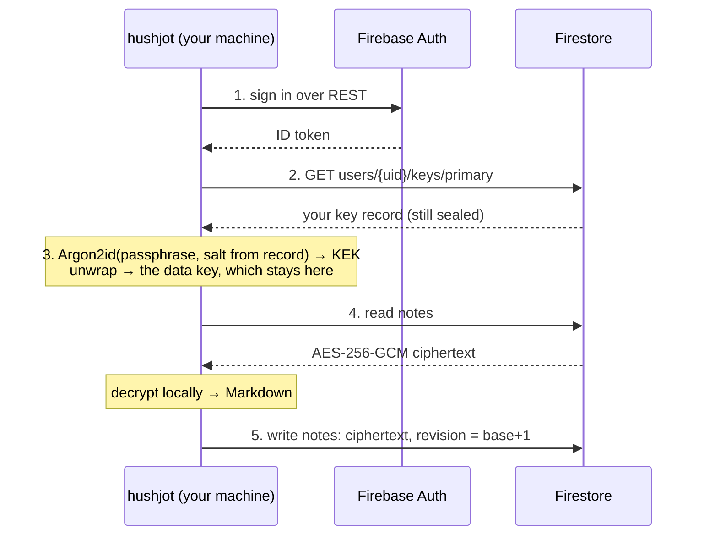

# hushjot

Your end-to-end encrypted [HushJot](https://hushjot.com) notes, from the terminal
and from an agent over MCP. **The key never leaves your machine.**

Agents can reach Bear and Obsidian notes through CLIs and MCP servers, but
those notes sit on disk as plaintext, and Obsidian has no browser version. Notesnook's API is write-only. Standard Notes has none. This is
the only one that is encrypted at rest, readable in any browser tab, *and*
scriptable by an agent on any machine you own.

```
$ git log --oneline -20 | hushjot push --folder Work
9f3c…  Release notes draft

$ hushjot search "argon2 #security"
Settling the KDF on hardware  (Notes/Security)
    3f2c8a91-…
    232.7 ms p50 on a Pixel 9a, no allocation failure at 64 MiB.

$ hushjot cat "Settling the KDF" | head -3
# Settling the KDF on hardware

232.7 ms p50 on a Pixel 9a, no allocation failure at 64 MiB.
```

## How it works



The backend is the same Firestore the web app syncs with, and it sees exactly
what it sees from a browser: ciphertext, a revision counter, and a timestamp.
The passphrase is typed into this process and goes nowhere else.

## Install

Requires **Node 22.18 or newer**, on macOS, Linux or Windows. There is no
bundler and no dependency graph to speak of — three runtime packages, and `tsc`
is the whole toolchain.

```bash
npm install -g @hushjot/cli
hushjot login
```

`npm update -g @hushjot/cli` updates it, and `npm uninstall -g @hushjot/cli`
removes it (run `hushjot logout` first, so nothing is left in the keychain).

To build it from source instead, check it out beside a checkout of the app,
whose `@hushjot/core` it is built against:

```bash
git clone https://github.com/hushjot/hushjot
git clone https://github.com/hushjot/hushjot-cli
cd hushjot && npm ci && npm run build:core
cd ../hushjot-cli
npm install
npm run local        # builds dist/, then links a global `hushjot`
hushjot login
```

`npm run unlink` removes the global command again. The build exists because Node
will not strip types under `node_modules`, so the installed entry point has to be
JavaScript; while developing, run `node src/bin/hushjot.ts` and skip it entirely.

`login` asks for your account email, account password and vault passphrase.

It cannot create a vault. Creating one issues a recovery code that has to be
shown to you exactly once, and a terminal scrollback — or an agent transcript —
is the wrong place for that. Create the vault in the browser, then log in here.

## Commands

| | |
|---|---|
| `hushjot ls [--folder F]` | List notes, pinned first, then by recency |
| `hushjot cat <note>` | Print one note's Markdown, byte for byte |
| `hushjot search <query>` | Full-text search; a `#term` filters by tag |
| `hushjot push [text]` | Create a note — also reads stdin, or `--file` |
| `hushjot append <note> [text]` | Add text to the end of a note |
| `hushjot replace <note> [text] --revision N` | Overwrite a note; the old text goes to History |
| `hushjot mkdir <path> [--parent F]` | Create a folder, and any missing folders above it |
| `hushjot pending` | Notes whose "Claude may continue." box is ticked (ready) or not yet (waiting) |
| `hushjot take <note>` | Pick up a ready note: append a receipt and print it |
| `hushjot reply [note] [text]` | Append to a note (default: the Inbox, created if missing), ending with a fresh `Done` box |
| `hushjot status` | What this machine is configured for |
| `hushjot scope [<folder> \| add F \| rm F \| clear]` | Show, set or change the folders every command is confined to |
| `hushjot logout` | Forget the key and the credentials |

`<note>` is an id, an exact title, or an unambiguous prefix of one. Ambiguity is
an error listing the candidates — never a guess, because `append` is on the
other side of it.

`--json` on any of them gives machine-readable output. Exit codes are meant to
be branched on: **4** you can fix, **5** is transient and worth retrying, **6**
is a write conflict, **8** means HushJot sync is paused for maintenance (nothing
was changed; try again later, the MCP tools say the same). An account may sync 20,000 changes a day; past that a
write exits **5** with "daily sync limit reached" and the time it can be
retried, and nothing is written.

**There is no `rm`, `mv` or `delete`.** The security rules refuse a hard delete
outright, and deleting is an app decision with a Recently Deleted screen behind
it. `replace` is the one verb that overwrites, and it cannot lose anything
either: it needs the revision you read (`cat --json`), so an edit made on your
phone since then makes it fail rather than vanish, and the text it replaces is
uploaded to the note's History in the same commit, restorable from the app for
30 days.

## MCP

```bash
hushjot scope Projects        # optional, and recommended
hushjot mcp enable            # or: hushjot mcp enable --read-only
claude mcp add hushjot -- hushjot mcp
```

Eleven tools: `hushjot_search`, `hushjot_cat`, `hushjot_ls`, `hushjot_pending`,
`hushjot_push`, `hushjot_append`, `hushjot_replace`, `hushjot_mkdir`,
`hushjot_take`, `hushjot_reply` and `hushjot_protocol`. With `--read-only`,
only the first four.

**Not only Claude Code.** It is a plain stdio MCP server, so any agent that can
launch one can use it. Setup guides, each with what has and hasn't been tested
yet, are in [`docs/agents.md`](docs/agents.md): Claude Code, OpenAI Codex,
GitHub Copilot (VS Code and CLI), Google Antigravity and Gemini CLI, xAI Grok
Build and Cursor. Pass `--agent <Name>` so the boxes and receipts in your notes
name the agent actually running (`Codex may continue.`); the default is Claude.

The server will not start until you enable it. Installing a CLI should not
silently make every note you have ever written available to a model, so that is
one deliberate action, taken once, by you.

**Scope.** `hushjot scope <folder>` confines every command and the server to that
folder's subtree, for reads *and* writes: a folder named in a tool call is
resolved only inside the scope, so an agent cannot write outside it, and an error
never lists folders it cannot see. `hushjot scope add <folder>` admits a second
folder. To give each Claude Code project its own folder, pin it per project:

```bash
cd ~/code/new-app
claude mcp add hushjot -- hushjot mcp --scope "Projects/new-app"
```

`--scope` can only narrow what `hushjot scope` allows, never widen it.

**What the scope is not.** It keeps an agent that uses the MCP tools on task. It
is not a sandbox against an agent that can also run shell commands as you: that
agent could run `hushjot scope clear` itself, or read the key from your keychain.
If your agent has a shell, deny it this CLI and the keychain tools (`security` on
macOS, `secret-tool` on Linux), for example in `.claude/settings.json`:

```json
{ "permissions": { "deny": ["Bash(hushjot *)", "PowerShell(hushjot *)", "Bash(security *)", "Bash(secret-tool *)"] } }
```

Windows has no equivalent rule: any PowerShell script can read Credential
Manager. On Windows, register the server as `cmd /c hushjot mcp …`, because npm
installs `hushjot` as a `.cmd` script that an agent cannot start without a shell.

And everything an agent reads through the server is sent to its model provider
in plaintext. That is the trade you make for having an agent read it at all.

**Nothing it can call destroys text.** `push` and `mkdir` only create, `append`
only adds, and `replace` refuses a stale revision and puts the old text in
History first.

### A project, from your phone

The server tells the model a working protocol when it connects (the
`instructions` in `src/mcp/server.ts`), built for this:

1. On your phone, make a folder `Projects/new-app` and write the requirements
   in it. Optionally add a note titled **Agent instructions** that says how you
   want the agent to work and what the final documents should contain.
2. At your desk, pin a Claude Code project to that folder (above), start it in
   auto mode, and run `/mcp__hushjot__plan`.
3. The agent reads everything and asks what it cannot decide in a new note,
   **Questions 01**, with its recommendation and an empty `Answer:` under each
   question. The note ends with
   `- [ ] I have answered all questions. Claude may continue.`
   Answer wherever you are, then tick the box. HushJot saves as you type, so
   until the box is ticked the agent ignores the note, even answers that look
   complete.
4. The agent writes `Docs/Plan`. It ends with a response section:

   ```markdown
   ## Your response

   - [ ] Approve: build this plan.

   Changes or questions (write below):

   - [ ] I have answered all questions. Claude may continue.
   ```

   Tick **Approve** and then the last box to build. To change the plan, leave
   Approve unticked, write what you want under *Changes*, and tick the last
   box. The agent replaces the plan with a revision that opens with **What
   changed**, and asks again. The old plan stays in History.
5. Let a loop check for you: `/loop 15m continue the HushJot project`. Use plain
   words: `/loop` passes an MCP prompt command to the model as text and does
   not run it. Each run starts with `hushjot_pending`. If nothing is ticked, it
   ends at once and writes nothing. The agent never stops the loop itself; you
   do (Esc, or close the session).
6. When the agent picks up a ticked note, `hushjot_take` appends
   `> Claude picked this up · <time>` under your box. You see that on your
   phone, and the agent never acts on the same tick twice.
7. As it finishes, it files **Summary**, **Architecture**, **Manual steps**,
   **Decisions** and **Changelog** in `Projects/new-app/Docs`. It revises them
   with `replace`, so every earlier draft is in History.
8. **The conversation carries on in the Inbox.** When the agent finishes
   something, or is blocked, it writes a report to a note called **Inbox**:
   - what it did;
   - the decisions it made on its own;
   - suggested next steps as `- [ ]` items;
   - a fresh `- [ ] Done. Claude may continue.` box.

   Tick the suggestions you want (*Initialise git and commit*, *Deploy*) or
   write your own requests under the report, then tick **Done**. The loop picks
   it up. If a request needs a permission Claude Code does not have, the agent
   says so in the Inbox, with the rule to add, rather than waiting at the
   terminal.

**Why the bookkeeping is in the server.** Which boxes are ticked, and which have
already been acted on, is parsed by the server (`src/gates.ts`) and recorded as
a receipt line in the note. The model doesn't have to remember it. The agent
only ever *appends* to your notes (the receipt and its replies), so it never
rewrites text you may be typing.

**Why auto mode, not plan mode.** A note cannot change Claude Code's permission
mode. Only you can, at the terminal, and that is deliberate: a note anyone with
your phone can edit should never be able to grant an agent anything. In plan
mode the agent also cannot write the Questions note. So the approval lives in
HushJot as the checkbox, and Claude Code runs in auto mode with the HushJot tools
allowed and the shell route to your keys denied:

```json
{
  "permissions": {
    "allow": ["mcp__hushjot__*"],
    "deny": ["Bash(hushjot *)", "PowerShell(hushjot *)", "Bash(security *)", "Bash(secret-tool *)"]
  }
}
```

The checkboxes are an agreement the agent is told to keep, not a permission
Claude Code enforces. Claude Code's own rules still decide what it may run. The
read tools carry the MCP `readOnlyHint`, but Claude Code does not document that
plan mode honours it, so do not rely on plan mode here.

`skills/hushjot-project/SKILL.md` is the same protocol as a skill, for clients
that do not show server instructions to the model. Copy it to
`~/.claude/skills/` for Claude Code, or `~/.agents/skills/` for Codex, Copilot,
Gemini and Grok. Clients with neither can call the `hushjot_protocol` tool.

**Agents without `/loop`.** `hushjot pending --wait` blocks until a note is
ready, then exits 0, so your own shell can start a headless agent only when
there is something to do:

```bash
while hushjot pending --wait --folder "Projects/new-app"; do
  codex exec resume --last "Continue the HushJot project."
done
```

## Where things are kept

| What | Where |
|---|---|
| Project id, API key, email, scope folders, MCP switches | `~/.hushjot/config.json` — none of it secret |
| Account password, refresh token, **data key** | your OS keychain |
| Ciphertext cache, delta cursor | `~/.hushjot/cache/<uid>/` |
| Your passphrase | nowhere — it is used and discarded |

**Why the data key is cached.** Argon2id costs about 95 ms, and an agent calling
`cat` in a loop would pay it every time. The browser app answers the same
problem the same way ("Stay unlocked on this device"), and the OS keychain is a
stricter place than the browser's IndexedDB. The cached key is named after the
blob your passphrase unwraps, so changing your passphrase on *any* device
invalidates it automatically.

**The cache holds ciphertext only**, exactly as the browser's IndexedDB does.
Copying that directory gets someone what a breach of the backend would give
them, and no more. The search index is deliberately *not* written to disk: a
serialised inverted index is the words of every note, in the clear, which is
most of what the encryption was for. It is rebuilt in memory on each search.

`hushjot logout` removes all three secrets. Your notes are untouched.

macOS uses the Keychain (`security`), Linux the system keyring (`secret-tool`,
from `libsecret-tools` or `libsecret`, with GNOME Keyring or KWallet running), and
Windows Credential Manager (through the built-in Windows PowerShell; the items
are `hushjot:<email>:…` under Windows Credentials). `hushjot status` says which.

Where none exists — a container, CI, a server without a desktop — nothing is
stored: set `HUSHJOT_PASSWORD` and `HUSHJOT_PASSPHRASE` in the environment, and
every command signs in and derives the key afresh. `HUSHJOT_SECRET_STORE=environment`
forces this where `secret-tool` is installed but no keyring answers it. Know that
it is the weaker option: an environment variable is readable by every process you
start, including an agent.

## What it will not do

- **Write your key record.** Read-only on `users/{uid}/keys/primary`, always.
  The rules allow updates there and refuse deletes, so a key record written from
  outside the app would be permanent and would lock out every browser device.
- **Guess.** An ambiguous note or folder is an error with the candidates listed.
- **Overwrite on a conflict.** §16 of the spec: never resolve a conflict
  destructively. `append` retries against fresh text, then gives up; `replace`
  refuses outright when the note moved since it was read.
- **Overwrite without a copy.** `replace` uploads the replaced text as a
  history version in the same atomic commit, or does not happen.
- **Assume a revision.** Every write reads the document first and sends
  `stored + 1`, because assuming zero is how the app once forked every note in
  an account on a loop.

## Development

```bash
npm run check             # tsc --noEmit; the only type gate
npm test                  # unit tests, no network
npm run test:integration   # the full journey against the Firestore emulator
npm run verify            # all three

npm run build             # emit dist/ — needed to install, not to develop
npm run local             # build + npm link → global `hushjot`
npm run unlink            # remove it again
```

The integration test needs the `firebase` CLI and Java. It runs against
`@hushjot/core/contract/firestore.rules` — the installed package's copy of the
app's real rules — and logs in with a frozen key record from
`@hushjot/core/contract/format-vectors.json`, so it proves this CLI unwraps
bytes the *app* sealed rather than bytes this repo invented.

Three runtime dependencies: `@hushjot/core`, `hash-wasm` (Argon2id, transitively)
and `@modelcontextprotocol/sdk`. Argument parsing is `node:util.parseArgs`, HTTP
is the global `fetch`, and the keychain is the OS binary — §28 of the spec says
prefer the platform, and here the platform is enough.

## Security

Please report vulnerabilities privately: see [SECURITY.md](SECURITY.md).

## Licence

Copyright © 2026 Nebulosa d'Ideias Unipessoal Lda.

Free software under the GNU Affero General Public License v3.0 only. See
[LICENSE](LICENSE).
