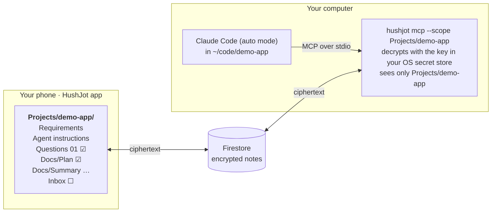

# Running the HushJot agent demo, step by step

By the end you'll have Claude Code working on a project whose requirements, questions, plan approval, documentation and follow-up requests all live in a HushJot folder you can edit from your phone.

Using Codex, GitHub Copilot, Gemini, Grok or Cursor instead? See [agents.md](agents.md). Those guides reuse Part 1, Steps 1 to 7, from this one.

It works on **macOS, Linux and Windows**. Where the commands differ, each block is labelled: **macOS / Linux** blocks are for bash or zsh, **Windows** blocks are for PowerShell. Unlabelled blocks work everywhere. Run each block from the directory it names.

> **Tested so far:** macOS, end to end. Linux and Windows are written from the code and from the vendors' docs, and haven't had a full run yet. If you're the first, please note anything that differs.

## How the pieces fit



Claude's reports and suggestions, and your next requests, all go through the **Inbox** note.

- **The MCP server is a local process.** Claude Code starts it when a session opens and stops it when the session ends. Nothing runs in the cloud, and there's nothing to keep running yourself.
- **Decryption happens only on your computer.** The agent's model provider does see the plaintext of what it reads, so keep the demo folder to things you're happy to share.

**One rule runs everything: the box.** Every note Claude waits on ends with a checkbox whose text ends in **"Claude may continue."**
- Until you tick the last one, Claude ignores the note. HushJot autosaves as you type, so it can't tell a finished answer from a half-typed one any other way.
- When Claude picks a ticked note up, it appends `> Claude picked this up · <time>` under your box. You see that on your phone, and Claude never acts on the same tick twice.

| Note | Who writes it | Ends with |
|---|---|---|
| Questions 01, 02… | Claude | `- [ ] I have answered all questions. Claude may continue.` |
| Docs/Plan | Claude | an **Approve** choice, a **Changes** space, then the same box |
| Inbox | Claude reports, you request | `- [ ] Done. Claude may continue.` |

---

## Part 1: One-time setup

### Step 1. Check the prerequisites

| You need | How to check |
|---|---|
| Node.js **22.18 or newer** | `node --version` |
| Claude Code, installed and signed in | `claude --version` |
| A HushJot account with **sync** (a paid plan or an allowlist invite) | Sync works in the app |
| A vault already created **in the app** (browser or phone) | You have a vault passphrase. The CLI can't create a vault. |
| Your account email, account password and vault passphrase | You know them |
| An OS secret store, for the key (see below) | `hushjot status` shows it after Step 4 |

**Node.js.** If you install Node with a version manager (nvm or fnm on macOS and Linux, nvm-windows or fnm on Windows), `npm install -g` works without `sudo`. With a system Node on macOS or Linux, a global install can fail with `EACCES`; switch to a version manager rather than using `sudo`.

**The secret store** keeps your account password, a sign-in token and the derived vault key, so you type the passphrase once:

| System | Store | What you need to do |
|---|---|---|
| macOS | Keychain | Nothing. |
| Windows 10 / 11 | Credential Manager | Nothing. The CLI reaches it through the built-in Windows PowerShell. |
| Linux desktop | GNOME Keyring or KWallet, through `secret-tool` | Install `secret-tool`: `sudo apt install libsecret-tools` (Debian, Ubuntu), `sudo dnf install libsecret` (Fedora) or `sudo pacman -S libsecret` (Arch). A desktop session normally has a keyring running and unlocked already. |
| Linux without a desktop, containers | None | See "No secret store" in Step 4. |

### Step 2. Install the CLI

**Option A: from npm (recommended).** The same command works on every system:

```bash
npm install -g @hushjot/cli
```

To update later, run `npm update -g @hushjot/cli`.

**Option B: build from source.** Use this if you want to read or change the code. The CLI imports the app's encryption and format code from the app repo's build output, so clone both side by side and build the app's core first. `path/to/` stands for the folder that holds both checkouts.

```bash
cd path/to
git clone https://github.com/hushjot/hushjot-app hushjot
git clone https://github.com/hushjot/hushjot-cli

cd hushjot
npm ci
npm run build:core     # should print: @hushjot/core … → dist-core/  (format v2, …)

cd ../hushjot-cli
npm install
npm run local          # builds dist/ and links a global `hushjot` command
```

- **Rerun `npm run local` after any change to the CLI's source**, or `hushjot` keeps running the old build.
- **Rerun `npm run build:core` in `hushjot`** whenever `hushjot/src/core` changes, then `npm run local` again.
- To run the tests as well: `npm run check && npm test`. `npm run test:integration` also needs the `firebase` CLI and Java.

### Step 3. Check the install

macOS / Linux:

```bash
which hushjot          # should print a path
hushjot --help         # should list replace, mkdir, pending, take, reply and the scope subcommands
```

Windows:

```powershell
where.exe hushjot      # should print a path ending in hushjot.cmd
hushjot --help
```

If `hushjot` isn't found, npm's global folder isn't on your PATH. `npm prefix -g` prints that folder. On macOS and Linux, its `bin` subfolder needs to be on PATH; on Windows, the folder itself does.

### Step 4. Sign in

```bash
hushjot login
```

It asks for three things:

| Prompt | Where to get it |
|---|---|
| Account email | Yours |
| Account password | Yours. It's stored in your OS secret store. |
| Vault passphrase | Yours. It's used once to unlock your notes and never stored. The derived key is cached in your OS secret store. |

Then confirm the setup:

```bash
hushjot status
hushjot ls --limit 5
```

`hushjot status` shows where secrets are kept, on its `Secrets in` line: `macos-keychain`, `windows-credential` or `libsecret`. On Windows, the items appear in **Credential Manager → Windows Credentials** as `hushjot:<your email>:…`.

`hushjot ls` matters before going further. The MCP server **can't ask for your passphrase**, because Claude Code owns its terminal. It only starts if the key is already cached in the secret store, and this command caches it.

**No secret store** (a Linux server without a desktop, a container): `hushjot status` shows `environment`. Then nothing is stored, and every command reads two environment variables instead, `HUSHJOT_PASSWORD` and `HUSHJOT_PASSPHRASE`. Set both before `hushjot login`, and in the environment the MCP server starts with.

- **This is the weaker option.** An environment variable can be read by every process you start, including the agent. Don't use it for an unattended agent if you can avoid it.
- On a Linux box where `secret-tool` is installed but no keyring is running, `hushjot login` fails with "could not write … via secret-tool". Start a keyring, or set `HUSHJOT_SECRET_STORE=environment` to use the environment on purpose.

### Step 5. Create the project folder and notes in HushJot

On your phone, or in the app at hushjot.app:

1. Create the folder **`Projects`** and, inside it, **`demo-app`**. From the terminal, `hushjot mkdir "Projects/demo-app"` does the same.
2. In `Projects/demo-app`, create a note called **Requirements**. Keep it small for the first run, for example:

   ```markdown
   # Requirements

   A command-line tip calculator in Node.js.
   - Takes a bill amount and a tip percentage
   - Splits the total between N people
   - Has tests
   ```

3. Optionally, create a note called **Agent instructions**. This is where you say how you want the agent to work and exactly what you want in the final documents. Its first line must be the title:

   ```markdown
   # Agent instructions

   - Ask at most 5 questions per round.
   - Use TypeScript and Vitest.
   - Final documents in Docs/:
     - Summary: what was built, in one screen
     - Architecture: modules and how data flows, with a Mermaid diagram
     - Manual steps: everything I must do by hand, numbered, with exact commands
     - Decisions: each decision and the question it came from
     - Changelog
   ```

Check that the CLI can see them:

```bash
hushjot ls --folder "Projects/demo-app"
```

### Step 6. Scope the CLI and enable the MCP server

```bash
hushjot scope Projects        # this machine may only ever see Projects/…
hushjot mcp enable            # allows the server to start (it is off by default)
hushjot status                # shows "Folder scope Projects" and "MCP server   enabled"
```

What these settings do:

| Setting | What it does | How to change it |
|---|---|---|
| `hushjot scope <folder>` | The **ceiling** for every command and every MCP server on this machine. Nothing outside it can be read or written. | `hushjot scope add <folder>`, `hushjot scope rm <folder>`, `hushjot scope clear` |
| `hushjot mcp enable` | Allows the server to start at all. | `hushjot mcp disable` |
| `hushjot mcp enable --read-only` | Exposes only search, cat and ls. **Don't use it for this demo**, because the agent needs to write. | Run `hushjot mcp enable` again |
| `hushjot mcp --scope <folder>` | Narrows **one server process**, meaning one Claude Code project, to one folder. It must lie inside the ceiling, or the server refuses to start. | Set in Step 8 |

The settings are saved in `~/.hushjot/config.json` (on Windows, `%USERPROFILE%\.hushjot\config.json`). `hushjot status` prints the exact path.

### Step 7 (optional). Check the server outside Claude Code

The MCP Inspector lets you call the tools by hand:

macOS / Linux:

```bash
npx @modelcontextprotocol/inspector hushjot mcp --scope "Projects/demo-app"
```

Windows:

```powershell
npx @modelcontextprotocol/inspector cmd /c hushjot mcp --scope "Projects/demo-app"
```

In the browser page it opens:
1. Click **Connect**, then **Tools → List**. You should see eleven tools.
2. Call `hushjot_ls`. You should see your two notes.
3. Call `hushjot_pending`. It should say nothing is ready.

If it fails to connect, see Troubleshooting at the end.

### Step 8. Create the code project and register the server with Claude Code

macOS / Linux:

```bash
mkdir -p ~/code/demo-app && cd ~/code/demo-app

claude mcp add hushjot -- hushjot mcp --scope "Projects/demo-app"
claude mcp list        # hushjot … ✓ Connected
```

Windows:

```powershell
New-Item -ItemType Directory -Force "$HOME\code\demo-app" | Out-Null
Set-Location "$HOME\code\demo-app"

claude mcp add hushjot '--' cmd /c hushjot mcp --scope "Projects/demo-app"
claude mcp list        # hushjot … ✓ Connected
```

- **In PowerShell, quote the `--` as `'--'`.** When `claude` was installed with npm it runs through a PowerShell script, and PowerShell would otherwise swallow a bare `--`. Quoted, it reaches Claude Code either way.

- **On Windows, start the server through `cmd /c`.** npm installs `hushjot` as a `hushjot.cmd` script, and a program that starts a server directly, without a shell, can't run a `.cmd` file. This applies to every agent and MCP client on Windows: wherever a guide has `"command": "hushjot", "args": ["mcp", …]`, use `"command": "cmd", "args": ["/c", "hushjot", "mcp", …]`.
- **Everything after `--` is passed to `hushjot` unchanged.** So `--scope "Projects/demo-app"` is HushJot's flag, not Claude Code's.
- **Claude Code also has a `--scope`.** It goes before the `--` and decides where the registration is stored:

| `claude mcp add --scope …` | Stored in | Use it when |
|---|---|---|
| `local` (the default) | `~/.claude.json`, under this project only | **This demo.** It's private to you and to this directory. |
| `project` | `.mcp.json` in the repo, which gets committed | A team shares the setup. Don't use it here: the folder name is personal. |
| `user` | `~/.claude.json`, for every project | Not recommended, because every project would get the same folder. |

For a second project, repeat this step in its directory with its own folder, for example `--scope "Projects/other-app"`.

Leave out `git init` for now. In Step 18 you'll ask for it from your phone, through the Inbox.

### Step 9. Set Claude Code's permissions for the project

Create **`~/code/demo-app/.claude/settings.local.json`** (on Windows, `%USERPROFILE%\code\demo-app\.claude\settings.local.json`). It's personal to you and git-ignored automatically. The same file works on every system: rules for a shell or command you don't have never match, so they do no harm.

```json
{
  "permissions": {
    "allow": [
      "mcp__hushjot__*",
      "Bash(npm *)",
      "Bash(npx *)",
      "Bash(git init)",
      "Bash(git add *)",
      "Bash(git commit *)",
      "Bash(git status)",
      "PowerShell(npm *)",
      "PowerShell(npx *)",
      "PowerShell(git init)",
      "PowerShell(git add *)",
      "PowerShell(git commit *)",
      "PowerShell(git status)"
    ],
    "deny": [
      "Bash(hushjot *)",
      "PowerShell(hushjot *)",
      "Bash(security *)",
      "Bash(secret-tool *)"
    ]
  }
}
```

| Rule | Why |
|---|---|
| `allow mcp__hushjot__*` | Lets the agent use all eleven HushJot tools without asking each time. That's what lets it work while you're away. |
| `allow … npm *`, `… npx *` | Install, build and test without asking. `PowerShell(…)` rules cover Claude Code's PowerShell tool on Windows. |
| `allow … git init`, `git add`, `git commit`, `git status` | Lets an Inbox request like *"Initialise git and commit"* run while you're out. `git push` is deliberately not on the list. |
| `deny … hushjot *` | Stops the agent running the CLI directly, where it could run `hushjot scope clear` and see your whole vault. |
| `deny Bash(security *)` | macOS: stops the agent reading the HushJot key out of the Keychain with the `security` tool. |
| `deny Bash(secret-tool *)` | Linux: the same, for the system keyring. |

On Windows there's no single command to deny: any PowerShell script can read Credential Manager. That's one more reason the scope isn't a sandbox (see below).

- **Deny always beats allow.**
- **Allow in advance anything you'll ask for from your phone.** If Claude Code stops to ask at the terminal, nobody is there to answer, and the loop waits until you're back. If a command is refused outright, the agent tells you in the Inbox which rule it needs.
- **Deploying from your phone** works the same way. Add the exact command, for example `"Bash(firebase deploy --only hosting)"`, and nothing broader. A ticked Inbox box then really can ship code, so only allow what you'd be happy to run from a note.
- **Precedence**, highest first: managed settings, then command-line flags, then `.claude/settings.local.json`, then `.claude/settings.json`, then `~/.claude/settings.json`.

**These deny rules only cover direct shell commands.** An agent that can run arbitrary code as you can reach the secret store some other way. The scope keeps an honest agent on task, but it isn't a sandbox. Keep the demo folder free of anything sensitive.

### Step 10. Choose the permission mode: auto

Claude Code's modes:

| Mode | What it does | For this demo |
|---|---|---|
| `default` | Asks before edits and commands. | Workable, but you'll be prompted constantly and it can't progress while you're out. |
| `acceptEdits` | Accepts file edits automatically, and asks before commands. | A safer fallback if `auto` isn't available to you. |
| `plan` | Read-only planning. | **Don't use it.** The agent can't write the Questions or Plan notes, and a note can't switch the mode. |
| **`auto`** | Lets Claude proceed without prompting on routine actions, while deny rules still apply. | **Use this.** |
| `bypassPermissions` | Skips all checks. | Don't. |

Start the session in auto mode:

```bash
cd ~/code/demo-app
claude --permission-mode auto
```

- To make auto the default, set `"permissions": { "defaultMode": "auto" }` in **`~/.claude/settings.json`** (on Windows, `%USERPROFILE%\.claude\settings.json`). Claude Code ignores `auto` in project settings files.
- **The HushJot checkboxes are your control point.** Auto mode lets Claude act, and the protocol tells it not to build until you approve the plan. Claude Code doesn't enforce the box. Your allow and deny rules are enforced.
- **Keep the computer awake.** The session, and with it the loop and the MCP server, pauses while the computer sleeps. For a long walk, plug in and, in another terminal:

  | System | Keep awake | Stop |
  |---|---|---|
  | macOS | `caffeinate -i` | Ctrl+C |
  | Linux (systemd) | `systemd-inhibit --what=idle:sleep --why=HushJot sleep infinity` | Ctrl+C |
  | Windows | `powercfg /change standby-timeout-ac 0` (never sleep while plugged in) | `powercfg /change standby-timeout-ac 30` |

  On Windows, Settings → System → Power → Sleep does the same as `powercfg`.

### Step 11 (optional). Install the skill

The server already sends the protocol to Claude Code when it connects. The skill is a backup copy that loads alongside it. It comes with the CLI.

macOS / Linux:

```bash
mkdir -p ~/.claude/skills
cp -r "$(npm root -g)/@hushjot/cli/skills/hushjot-project" ~/.claude/skills/
```

Windows:

```powershell
New-Item -ItemType Directory -Force "$HOME\.claude\skills" | Out-Null
Copy-Item -Recurse -Force "$(npm root -g)\@hushjot\cli\skills\hushjot-project" "$HOME\.claude\skills\"
```

If you built from source (Option B), copy `path/to/hushjot-cli/skills/hushjot-project` instead. Copy it again after updating the CLI.

---

## Part 2: Running the demo

### Step 12. Check the connection

Inside Claude Code, type:

```
/mcp
```

`hushjot` should show as connected, with 11 tools. If it shows as failed, see Troubleshooting.

### Step 13. Start planning

```
/mcp__hushjot__plan
```

(It also appears in the `/` menu as `/hushjot:plan (MCP)`.)

The agent should then:
1. Read **Requirements** and **Agent instructions**.
2. Create **`Questions 01: …`** in `Projects/demo-app`. Each question has its context, a recommendation and an empty `Answer:` line, and the note ends with `- [ ] I have answered all questions. Claude may continue.`
3. Stop, and tell you the questions are waiting in HushJot.

### Step 14. Answer on your phone, and test the autosave guard

1. Open **Questions 01** and answer the first question only. **Don't tick the box.**
2. Back in Claude Code, run `/mcp__hushjot__continue`. **Expected:** it calls `hushjot_pending`, sees the note is *waiting*, and ends its turn without writing anything. This proves it won't act on half-typed answers.
3. Answer the rest and **tick the box**. In the app's preview, the checkbox is tappable.
4. On the next check, Claude takes the note. **Expected:** a line `> Claude picked this up · <time>` appears under your box.

### Step 15. Let it run while you're away

Instead of prompting by hand, start a loop:

```
/loop 15m continue the HushJot project
```

- **Use plain words.** `/loop` passes MCP prompt commands such as `/mcp__hushjot__continue` to Claude as plain text instead of running them. The plain sentence works because the protocol is already in Claude's context.
- **Intervals** can be `30s`, `5m`, `1h` or `1d`; the minimum is one minute. Without an interval, `/loop continue the HushJot project` lets Claude choose the delay each time.
- **Stopping:** press `Esc` for a loop without an interval, or cancel a fixed one from the task list. Loops expire after 7 days.
- **Claude never stops the loop itself**, so the Inbox keeps working after the build. If yours stops anyway, see Troubleshooting.
- **The session must stay open.** A loop belongs to the session; `claude --resume` restores it.
- **An empty check costs almost nothing.** Each check makes one `hushjot_pending` call and, if nothing is ready, ends there.

Then, on your phone:
- **Questions NN:** answer, then tick the last box.
- **Docs/Plan:** write changes and tick the last box → a revised plan. Or tick **Approve** and the last box → Claude builds.
- **Inbox:** tick suggestions or write requests, then tick **Done** → Claude does them and posts a new report.

What happens next:
1. With your answers ticked, it may ask follow-ups in **Questions 02**, with the same box.
2. Otherwise it writes **`Docs/Plan`** and stops. The plan ends like this:

   ```markdown
   ## Your response

   - [ ] Approve: build this plan.

   Changes or questions (write below):

   - [ ] I have answered all questions. Claude may continue.
   ```

### Step 16. Respond to the plan on your phone

Try the change path first, so you've seen it work:

1. Read **Docs/Plan**. Leave **Approve** unticked, write a change under *Changes or questions*, for example "Also support splitting by percentages", and tick the **last** box.
2. **Expected, on the next check:**
   - the receipt appears under your box;
   - then the plan is replaced by a revision that opens with **What changed**, quoting your request and saying how it was handled, and ends with a fresh, unticked footer;
   - the previous plan, including what you wrote, is in the note's **History**.
3. Now tick **Approve**, and then the last box. If you also write something under *Changes*, Claude applies it while building and records it in **Decisions**.
4. On the next check it starts building in `~/code/demo-app`.

Ticking **Approve** alone does nothing until the last box is ticked too, so a stray tap can't start a build.

### Step 17. Read the documents and the first Inbox report

As it finishes, it writes into `Projects/demo-app/Docs`: **Summary**, **Architecture**, **Manual steps**, **Decisions** and **Changelog**, or whatever your Agent instructions asked for. It keeps them current with `replace`, so:

- in the app, open a document's **History** to see every earlier draft;
- if you edit a document it wrote while it's also revising it, its replace is refused, it re-reads your version, and it merges.

You can also ask for documentation at any time with `/mcp__hushjot__document`.

When the build is done, Claude also writes to a note called **Inbox** in `Projects/demo-app`, which it creates the first time. Its report has:
- what it did, pointing to the Changelog;
- the decisions it made on its own, which you can contest;
- suggested next steps as checkboxes, for example `- [ ] Initialise git and make the first commit`;
- a fresh `- [ ] Done. Claude may continue.` box.

The terminal shows a short summary too, but the Inbox is the copy meant for you.

### Step 18. Keep it going from the Inbox

The loop keeps running after the build. Anything you want next goes through the Inbox:

1. Open **Inbox**. Tick **Initialise git and make the first commit**. You can also type requests of your own under the report, for example "Add a --currency flag".
2. Tick **Done. Claude may continue.**
3. **Expected, on the next check:**
   - the receipt appears;
   - Claude runs `git init`, adds and commits, and does your other requests;
   - it appends a new report with a fresh Done box.
4. Repeat for as long as you like: fixes, features, documentation, or a deploy if you allowed one in Step 9.

**If a request needs a command you haven't allowed** (for example `git push`), the request isn't lost. Claude says in the Inbox that it was blocked, and which rule to add to `.claude/settings.local.json`. Add the rule at your desk, then tick Done again.

The Inbox is your note: tidy or clear it whenever you like. Claude only ever appends to it.


### Step 19. Clean up afterwards (optional)

In Claude Code, stop the loop (Esc, or cancel it in the task list). Then, from `~/code/demo-app`:

```bash
claude mcp remove hushjot      # unregister for this project
hushjot mcp disable            # no server can start
hushjot scope clear            # or keep the Projects ceiling
hushjot logout                 # forget the key, password and token
npm uninstall -g @hushjot/cli  # remove the command (from source: npm run unlink in hushjot-cli)
```

Your notes are untouched by all of these. Run `hushjot logout` before uninstalling, or the items stay in your secret store.

---

## Troubleshooting

| Symptom | Cause | Fix |
|---|---|---|
| `/mcp` shows hushjot as **failed**, or `claude mcp list` isn't connected | The server exited at startup. Its message is in Claude Code's MCP logs. | Run `hushjot mcp --scope "Projects/demo-app"` in a terminal: errors print there, and if it's healthy it waits silently (Ctrl+C to quit). |
| "The MCP server is not enabled" | You haven't run `hushjot mcp enable`. | Run it. |
| "Cannot start the MCP server … passphrase" | The key isn't cached in your secret store. | Run `hushjot ls` once and enter the passphrase. |
| Windows: the server fails with `spawn hushjot ENOENT`, or "Connection closed" | The client can't start `hushjot.cmd` without a shell. | Register it as `cmd /c hushjot mcp …` (Step 8). |
| `hushjot` isn't found after installing | npm's global folder isn't on PATH. | See Step 3. |
| Linux: "could not write … via secret-tool" at login | `secret-tool` is installed, but no keyring is running or it's locked. | Log in to a desktop session, or start `gnome-keyring-daemon`. Otherwise use the environment (Step 4). |
| `hushjot status` shows `Secrets in environment`, and every command asks for the passphrase | No secret store was found. | macOS and Windows always have one. On Linux, install `secret-tool` (Step 1), or set `HUSHJOT_PASSWORD` and `HUSHJOT_PASSPHRASE`. |
| "… is outside the folder scope" at startup | `--scope` names a folder outside `hushjot scope`. | Run `hushjot scope add Projects`, or fix the folder name. |
| "No folder matching … configured as a folder scope" | A scope folder was renamed or deleted in the app. | Run `hushjot scope` to see the entries, then `hushjot scope set <new name>`. |
| `hushjot` is missing new commands | The global install is old. | `npm update -g @hushjot/cli`. From source: rerun `npm run local` in `hushjot-cli`, after `npm run build:core` in `hushjot` if core changed. |
| "That account has no active sync plan" | The account isn't approved for sync. | Get a plan at hushjot.com/account, or check your allowlist entry. |
| "HushJot sync is paused for maintenance" | Sync is paused on the service side. Nothing was changed. | Wait; it can be hours. A running loop carries on by itself once sync resumes. |
| "The daily sync limit is reached" | The account has synced its daily number of changes. Nothing was written. | The message says when to try again. Notes already synced are unaffected. |
| "Sync storage is full" | The account's storage allowance is used up. | Delete notes in the app, or add storage at hushjot.com/account. |
| A replace is refused as a conflict | You, or another device, edited the note after the agent read it. | Expected. The agent re-reads and retries. |
| A replace is refused: "history allowance is used up" | This month's history upload budget (500 MB) is spent. | Nothing changed. The agent should push a new note or append instead. |
| The agent stopped the loop itself after building | The CLI, or the skill copy in `~/.claude/skills`, is out of date. | Update the CLI (`npm update -g @hushjot/cli`, or `npm run local`), copy the skill again (Step 11), restart Claude Code, and start the loop again. |
| You ticked a box but nothing happens | Either the loop isn't running, the computer was asleep, or it's waiting at a permission prompt in the terminal. | Check the terminal. Run `hushjot pending` in a shell: your note should say `ready`. |
| A request in the Inbox was "blocked" | Claude Code refused a command that has no allow rule. | Add the rule the report names to `.claude/settings.local.json`, then tick Done again. |
| The receipt line appeared, but no reply came | The work is still running, or it ended with an error. | Look at the terminal. The agent should report errors in the Inbox; if it didn't, ask it to with `/mcp__hushjot__continue`. |
| The agent acted on a note before you ticked it | It didn't follow the protocol. | Check `/mcp` shows the server connected (the instructions come from it), install the skill (Step 11), and say "follow the HushJot protocol" in your prompt. |
| Tools prompt for permission every time | The allow rule isn't loaded. | Check the path is `.claude/settings.local.json` inside the project, and the rule is `mcp__hushjot__*`. Then restart the session. |
| `auto` isn't accepted as a mode | It isn't available to your account, or it's set in a project file. | Use the `--permission-mode auto` flag or user settings, or fall back to `acceptEdits`. |

## Quick reference

```bash
# one-time
npm install -g @hushjot/cli          # or build from source: Step 2, Option B
hushjot login
hushjot ls --limit 5                 # caches the key
hushjot scope Projects
hushjot mcp enable

# per project (macOS / Linux; on Windows see Step 8)
mkdir -p ~/code/demo-app && cd ~/code/demo-app
claude mcp add hushjot -- hushjot mcp --scope "Projects/demo-app"
#   Windows:  claude mcp add hushjot '--' cmd /c hushjot mcp --scope "Projects/demo-app"
#   plus .claude/settings.local.json: allow mcp__hushjot__*, npm, npx, git init/add/commit/status;
#   deny hushjot, security (macOS), secret-tool (Linux)
caffeinate -i &        # keep awake: macOS. Linux: systemd-inhibit; Windows: powercfg (Step 10)
claude --permission-mode auto

# in Claude Code
/mcp
/mcp__hushjot__plan
/loop 15m continue the HushJot project
```
